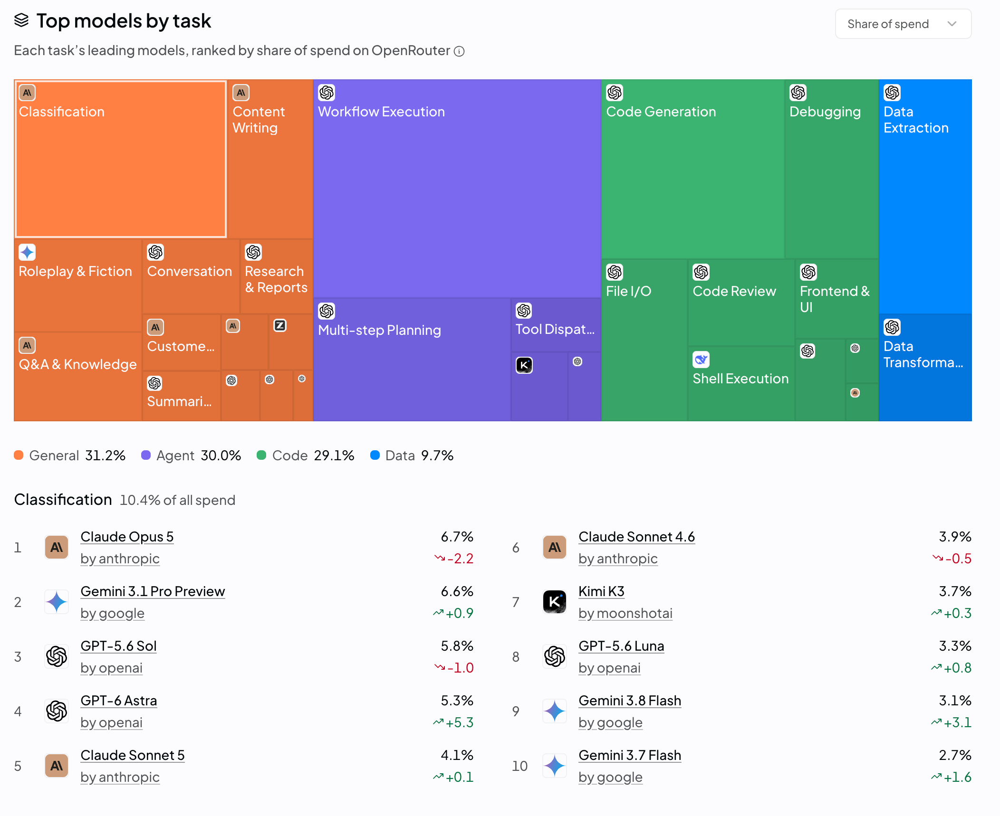
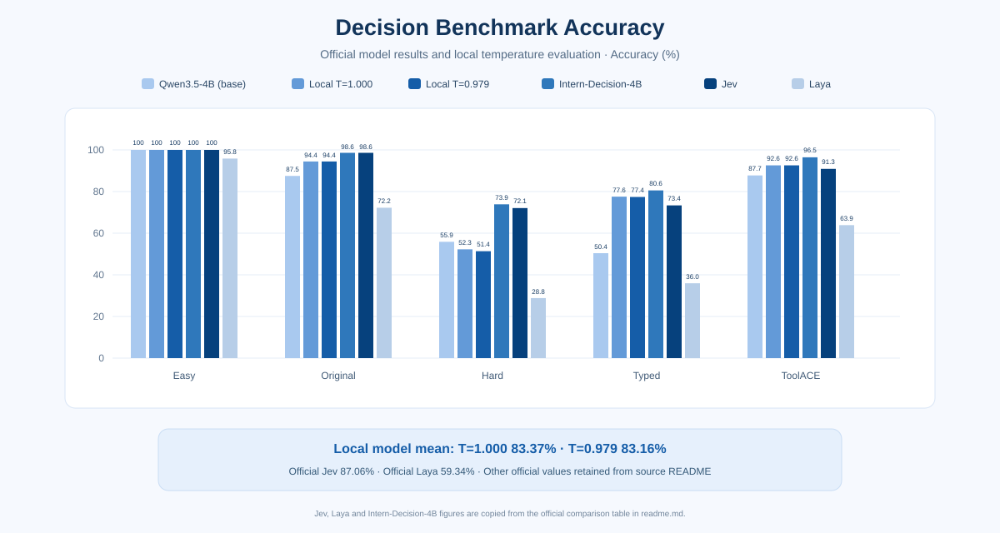
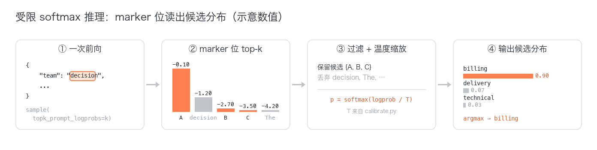
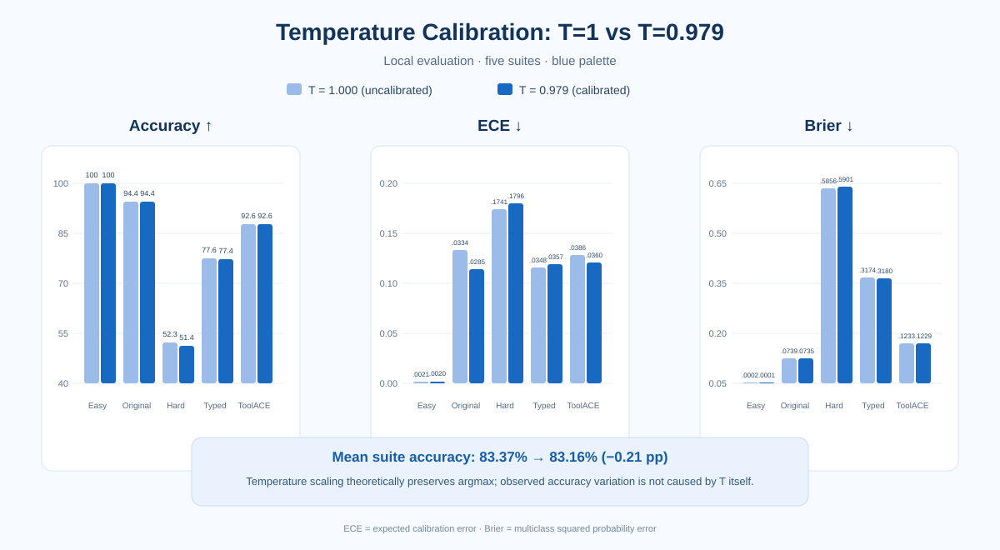

# Qwen3.5-4B-Jev — 决策模型

我用 **2160 条训练数据、2 个 epoch、312 步 LoRA** 做了一次决策模型实验。在与 Intern-Decision 公开榜单一致的五项评测集上，五项简单平均准确率从 base 的 **76.30%** 提到未校准的 **83.37%**；温度校准后为 **83.16%**。Typed Decision 和 ToolACE 两项超过 Jev，但 Hard 仍有明显差距，比较时也要注意 specialist 与零样本等口径差异。

数据共 **2400 条：2160 条训练 + 120 条 dev + 120 条 calibration**，不是 2400 条全部用于训练。

**代码与复现资源**

- 完整代码：[pytrio_jev](https://github.com/pk7j7sqryy-ops/pytrio_jev) / 快速启动：[`start.md`](https://github.com/pk7j7sqryy-ops/pytrio_jev)
- 方法参考：[`09-pytrio-jev`](https://github.com/KMnO4-zx/agentic-rl-lab/tree/main/09-pytrio-jev)、[Intern-Decision](https://github.com/InternLM/Intern-Decision)、[Jev 架构逆向](https://archerhume.com/posts/jevs-architecture-unmasked)、[Datawhale AgentJev 教程](https://mp.weixin.qq.com/s/F7i83rn8oDzQ-sg13MKwWA)
- 训练数据：[`LocalLLaMA/typed-decisions`](https://huggingface.co/datasets/LocalLLaMA/typed-decisions)、[`Team-ACE/ToolACE`](https://huggingface.co/datasets/Team-ACE/ToolACE)
- SwanLab：[查看本次实验公开的训练记录](https://swanlab.cn/@js9527/agentic-rl-lab-pytrio-jev/v1/8w9aka/runs?utm_source=website_qr&utm_medium=qr_scan)
- PyTRIO：[官网](https://pytrio.com) / [官方文档](https://docs.pytrio.com/docs)

## 目录

- [1. 什么是 Jev](#what-is-jev)
  - [1.1 定位与使用方式](#jev-positioning)
  - [1.2 一个售后判断例子](#jev-example)
  - [1.3 为什么我关注这类模型](#jev-background)
- [2. 实验结果](#experiment-results)
- [3. 项目结构](#project-structure)
- [4. 数据准备](#data-preparation)
  - [4.1 来源与切分](#data-splits)
  - [4.2 评测集](#evaluation-datasets)
- [5. 数据处理与稀疏监督](#data-processing)
  - [5.1 数据长什么样：canonical record](#canonical-record)
  - [5.2 三种题型与标签归一化](#question-types)
  - [5.3 compile_record → encode → build_sft_datum](#encoding-pipeline)
  - [5.4 decision 占位符：为什么要它](#decision-placeholder)
  - [5.5 build_sft_datum：拼出训练样本](#sft-datum)
  - [5.6 训练 input 与 target 示例](#training-example)
  - [5.7 loss 对齐：为什么中间引号闭合不算 loss](#loss-alignment)
- [6. 训练流程](#training-flow)
- [7. 推理流程](#inference-flow)
  - [7.1 总体流程与输入](#inference-overview)
  - [7.2 _field_logprobs：提取候选分数](#field-logprobs)
  - [7.3 中间处理结果](#intermediate-results)
  - [7.4 受限 softmax](#restricted-softmax)
  - [7.5 believe：分布确定性分数](#believe)
  - [7.6 最终输出](#inference-output)
- [8. 温度校准与评测](#calibration-evaluation)
  - [8.1 为什么校准](#calibration-motivation)
  - [8.2 指标定义](#evaluation-metrics)
  - [8.3 ECE 与 Brier 示例](#metric-examples)
  - [8.4 温度拟合结果](#calibration-results)
  - [8.5 评测结果与限制](#evaluation-results)
- [9. 快速上手](#quick-start)
- [10. 关键设计决策](#design-decisions)
- [附录 A：两种温度优化方法](#temperature-methods)
  - [A.1 数据只收集一次](#collect-instances)
  - [A.2 黄金分割法：试温度、比较平均 NLL](#golden-section)
  - [A.3 牛顿法：用梯度和曲率更新温度](#newton-method)
  - [A.4 两种方法对比](#methods-comparison)

<a id="what-is-jev"></a>
## 1. 什么是 Jev

<a id="jev-positioning"></a>
### 1.1 定位与使用方式

按 Jev 的官方介绍，它并非生成式大语言模型（LLM），而是面向 Agent、软件执行循环的「System One 快速决策模型」。它不输出自由文本、思维链，而是直接输出经过校准概率的结构化决策，专门承担 Agent 流程里的判断、路由、校验闸门工作。

说人话：它不生成文本 Token，而是直接输出概率的分类决策模型，适合意图识别、路由判定等二选一 / 多选型决策场景。

使用方式是向模型传入一段背景状态（state）以及一组附带固定候选选项的问题（questions），模型仅返回「选择哪个选项、对应置信概率」。本文实现采用候选符号的 logprob 与受限 softmax 完成这一过程，具体见[第 7 节](#inference-flow)。

<a id="jev-example"></a>
### 1.2 一个售后判断例子

```text
示例输入：
状态：客户正在进行商品售后咨询
问题：判断客户当前情绪状态，A 一般，B 紧急，C 非常紧急

示例输出：
选择 A，概率 90%；选项 B，概率 9%；选项 C，概率 1%
```

<a id="jev-background"></a>
### 1.3 为什么我关注这类模型

在OpenRouter 的 "Top models by task" 统计里，**Classification 一个任务就占了全平台 10.4% 的花销**，是 General 类别（31.2%）下最大的单一任务：



**只需要一个快、稳、概率可信的决策**。让一个通用大模型每次都想半天再做这种三选一，是拿慢思考做快思考的活。
快思考和慢思考需要协同配合，慢思考负责开放世界的推理与规划，快思考负责高频、固定、可枚举的路由与决策。Jev 这类模型填的就是快思考这一格。

具体到的有多快？
**官方标称端到端 API 延迟：70ms ~ 500ms**（包含模型推理 + 服务层，不含你本地到海外 API 的网络 RTT）jevforagen...

- 最优小输入、少问题场景：下限贴近 **70ms**
- 常规业务（像你刚才 2 条 case 这种，多 question、几百 token 输入）：大多落在 **200–350ms**
- 大上下文 / 大量子问题批量决策：靠近上限 500ms

> 官方对比口径：同分类打分任务，比前沿生成式 LLM **快 40～200 倍**（LLM 这类任务往往是 3s+）

为什么这么快？
	推理是**只跑一次 prefill（单轮前向）、不逐 token 解码，只输出概率，choice/score/noul 多个问题在同一个请求里并行算，不是串行

注意:本**项目仍然要经过 LM head**“，不逐 token 解码”省掉的是**把生成结果不断拼回输入、再继续生成的循环**，不是省掉输出层，省掉了**“生成循环”**

<a id="experiment-results"></a>
## 2. 实验结果

评测集与 Intern-Decision 官方榜单一致：Jevbench 三档 + Typed Decision test + ToolACE 310 条。下表均为 Accuracy（准确率，%），平均列是五项的简单算术平均：

| 模型 | Easy | Original | Hard | Typed | ToolACE | 平均 |
| --- | ---: | ---: | ---: | ---: | ---: | ---: |
| Qwen3.5-4B（base） | 100.00 | 87.50 | 55.86 | 50.40 | 87.74 | 76.30 |
| **PyTrio-Jev（本文）** | 100.00 | 94.44 | 52.25 | 77.55 | 92.58 | **83.37** |
| **PyTrio-Jev（+温度校准）** | 100.00 | 94.44 | 51.33 | 77.40 | 92.58 | **83.16** |
| Intern-Decision-0.8B | 97.92 | 80.56 | 52.25 | 77.35 | 94.52 | 80.52 |
| Intern-Decision-2B | 100.00 | 84.72 | 63.96 | 79.35 | 96.45 | 84.90 |
| Intern-Decision-4B | 100.00 | 98.61 | 73.87 | 80.55 | 96.45 | 89.90 |
| Jev | 100.00 | 98.61 | 72.07 | 73.35 | 91.29 | 87.06 |
| Laya | 95.83 | 72.22 | 28.83 | 35.95 | 63.87 | 59.34 |

官方数值来自 [Intern-Decision 公开榜单](https://github.com/InternLM/Intern-Decision)。比较时需要注意两个口径差异：

- 官方模型在 Typed Decision 上是**零样本**评测，而我这里是 specialist 模式（train/test 同 workflow）。
- 官方是全参数微调，我这里是 LoRA；数据共 2400 条，其中只有 **2160 条用于训练**，其余为 120 条 dev 和 120 条 calibration。

图中的 Local T=1 对应 PyTrio-Jev（本文），Local T=0.979 对应 PyTrio-Jev（+温度校准）。



> 待核对：原总榜的 Hard 校准准确率为 **51.33%**，第 8 节原详细表为 **51.35%**；这里保留两处原始数字，不擅自统一。正温度缩放本身不改变 argmax，校准前后准确率的差异沿用原文的运行间输出差异 / 数值扰动解释，详见[评测结果与限制](#evaluation-results)。

<a id="project-structure"></a>
## 3. 项目结构

```text
jev/
├── 00-prepare-data.py      下载 + 切分数据集（HF）
├── data.py                 数据处理核心：compile_record / Encoder / build_sft_datum
├── train.py                异步 LoRA masked SFT 训练主循环
├── inference.py            受限 softmax 推理
├── calibrate.py            黄金分割法温度校准
├── calibrate_newton.py     牛顿法温度校准
├── eval.py                 准确率、ECE 与 Brier 评测
├── cyber-security-data.py  额外数据源（安全告警，流式采样 200 条）
├── templates/qwen3_5_jev.jinja   钉死的 chat template
├── prompt/                 提示词文件（data / sft 两类）
└── datasets/
    ├── train.jsonl         训练集（typed-decisions 960 + ToolACE 1200）
    ├── dev.jsonl           早停评估集（120 条）
    ├── calibration.jsonl   温度拟合集（120 条）
    └── eval/*.jsonl        五个评测基准
```

<a id="data-preparation"></a>
## 4. 数据准备

<a id="data-splits"></a>
### 4.1 训练来源与切分

`00-prepare-data.py` 从 HuggingFace 拉两个数据集，统一转成 **canonical record** 格式。

| 来源 | 用途 | 切分 |
| --- | --- | --- |
| `LocalLLaMA/typed-decisions` | 训练数据 | typed-decisions train 切出 960 案例 |
| `Team-ACE/ToolACE` | 训练数据 | 采样 1200 条，避开 eval 集 |
| `LocalLLaMA/typed-decisions` | 训练验证数据 | typed-decisions 案例级切分 120 案例（选优用） |
| `LocalLLaMA/typed-decisions` | 温度校准数据 | typed-decisions 案例级切分 120 案例（温度拟合用） |

因此训练集为 `960 + 1200 = 2160` 条，加上 dev 和 calibration 后总计 `2160 + 120 + 120 = 2400` 条。dev 用于早停和选优，calibration 独立用于温度拟合，二者不计入训练条数。

<a id="evaluation-datasets"></a>
### 4.2 评测集

| 基准 | 规模 | Intern-Decision-4B 参考 |
| --- | ---: | ---: |
| Jevbench Easy | 48 | 100.00% |
| Jevbench Original | 72 | 98.61% |
| Jevbench Hard | 111 | 73.87% |
| Typed Decision test | 400 案例 / 2000 题 | 80.55% |
| ToolACE | 310 | 96.45% |

<a id="data-processing"></a>
## 5. 数据处理与稀疏监督

<a id="canonical-record"></a>
### 5.1 数据长什么样：canonical record

一条记录包含四块：**状态**（state）、**问题**（questions）、**答案**（targets），外加一个 id。

```jsonc
{
  "id": "tr_security_incidents_000178",
  "state": {                      // 案情：给模型看的输入事实
    "alert":   { "description": "...", "evidence": "...", "rule": "mass_download" },
    "context": { "asset_criticality": "medium", "change_window_active": true, "source_on_allowlist": false },
    "history": { "credential_rotation_days_ago": 3, "distinct_countries_30d": 4, "logins_30d": 688, "prior_alerts_90d": 0 },
    "principal": { "mfa_enrolled": true, "name": "svc-analytics-473", "privileges": ["repo:read"], "type": "ci_runner" }
  },
  "questions": {                  // 要判断哪些字段、各有哪些选项
    "credential_compromise": { "type": "noul",   "instructions": "..." },
    "disposition":          { "type": "choice", "criteria": { "close_benign": "...", "contain": "...", "investigate": "...", "monitor": "..." } },
    "severity":             { "type": "score",  "criteria": ["Negligible...", "Low...", "Moderate...", "High...", "Critical..."] },
    "true_positive":        { "type": "noul",   "criteria": { "false": "...", "true": "..." } },
    "urgency":              { "type": "score",  "criteria": ["...", "...", "...", "..."] }
  },
  "targets": {                    // 正确答案
    "credential_compromise": { "label": "true" },
    "disposition":          { "label": "investigate" },
    "severity":             { "label": "2" },
    "true_positive":        { "label": "true" },
    "urgency":              { "label": "2" }
  }
}
```

<a id="question-types"></a>
### 5.2 三种题型与标签归一化

每个字段都有一个 `type`，决定选项怎么展开成符号。这一步发生在数据处理阶段，训练和推理共用同一套映射。

| 题型 | 含义 | 选项展开方式 | 符号来源 |
| --- | --- | --- | --- |
| `choice` | 从若干选项中选一个 | `criteria` 字典的 key 按**插入序** | A, B, C, … |
| `score` | 打分（0~N 等级） | `criteria` 列表按**等级序** | A, B, C, … |
| `noul` | 二值判断（yes/no） | 固定 `[no, yes]` | A=no, B=yes |

> 符号表是固定的 62 个单 token 符号：`A-Z` + `a-z` + `0-9`（`ANSWER_SYMBOLS`）。因为服务端词表不可扩展，选符号必须用词表里已有的**单 token**，才能精确映射到 token id。

标签归一化（`normalize_label`）：`noul` 型的 `true/false/1/0` 统一归一成 `yes/no`；其他题型直接转字符串。这样「标签 → 选项值 → 下标 → 符号」是一条干净链路。

<a id="encoding-pipeline"></a>
### 5.3 compile_record → encode → build_sft_datum

数据从「一条结构化记录」到「模型可训练的一个样本」，走三步：

```text
canonical record
    │
    ▼
compile_record：展开题型、选项与标签，建立字段和符号映射
    │
    ▼
encode：文本 → 固定 chat template → tokens → markers
    │
    ▼
build_sft_datum：构建 model_input、target_tokens 与 weights
```

最终需要三组数据：

- `model_input = ids[:-1]`：去掉最后一个 token，作为模型输入。
- `target_tokens = ids[1:]`：作为 next-token 预测目标，与输入错开一位，其中答案位置被覆盖成正确符号 token id。
- `weights`：只在答案预测位置为 `1`，其余全为 `0`。

<a id="decision-placeholder"></a>
### 5.4 decision 占位符：为什么要它

**`decision` 占位符是用来「标记位置」的，不是用来「当答案」的。**

训练时模型最终需要三样东西：`ids[:-1]`（输入）、`ids[1:]`（预测目标）、`weights`（哪些位置要监督）。前两个都好确定，唯独 **weights 不好定**——因为我要「只监督答案符号」，得知道答案符号到底在 token 流的哪个位置。

`decision` 占位符就是干这个的，它有两个作用：

1. **定位（markers）**：`decision` 在 Qwen3.5 词表里是单 token（id 61781），且正文里几乎不会作为独立 token 出现。在骨架里扫它的命中位置，就能精确知道「每个字段的答案该落在哪」，得到 markers。
2. **替换监督目标**：模型需要预测的是 A/B/C 这些符号，不是 `true` / 选项文本 / 分数。markers 让「把目标中的答案位置从 `decision` 覆盖成正确符号 id」这件事变成一行代码；输入骨架仍保留占位符。

**为什么不用「全 token 监督」替代占位符？** 每个 token 都算 loss 虽然省事，但会把训练信号浪费在「学格式」上，决策能力被稀释。占位符让「只监督 5 个符号」从「很难」变成「一行代码」。**占位符不是训练的必要条件，而是「稀疏监督」的工程实现手段。**

<a id="sft-datum"></a>
### 5.5 build_sft_datum：拼出训练样本

`build_sft_datum(record)` 把编码好的东西拼成 PyTRIO 的 `Datum`，核心处理如下：

```python
encoded = self.encode(record)
ids = encoded["ids"]
target_tokens = list(ids[1:])          # 预测目标 = 输入错开一位
weights = [0.0] * len(target_tokens)  # 默认全 0
for field, symbol in encoded["targets"].items():
    position = encoded["markers"][field] - 1  # marker 前一位置
    target_tokens[position] = self.symbol_token_id(symbol)  # 覆盖成正确符号 id
    weights[position] = 1.0  # 只有这里算 loss
```

**为什么是 `marker - 1`？** 因为 `markers[field]` 指向的是 `decision` 这个占位 token 的位置，而「预测答案符号」这件事发生在它**前一个位置**——模型在这个位置读的是前面的引号 `"`，要预测的下一个 token 才是答案符号，详见[loss 对齐图示](#loss-alignment)。

<a id="training-example"></a>
### 5.6 训练 input 与 target 示例

下面用同一条售后记录展示输入与目标。按选项映射，正确答案依次是：`team=A`（billing）、`urgency=C`（等级 2）、`refund_requested=B`（yes）。

**输入骨架（token 化和 `ids[:-1]` 切片前的文本）**：

```text
<|im_start|>system
You are a careful decision assistant. Use the state and decision schema in the user message to make the requested decisions. For every field, choose exactly one answer symbol (e.g. A, B, C, ...) from its listed options and return one valid JSON object mapping each field name to its chosen symbol. Use the field names and symbols exactly as given. Do not include explanations, Markdown, or extra text.<|im_end|>
<|im_start|>user
Return one answer for every field using the supplied answer symbols.

## State
{
  "customer_message": "I bought headphones yesterday and noticed today that I was charged twice. Please refund the extra charge as soon as possible."
}
## Decision schema
team: Which team should handle this ticket?
    A = billing: Payments and refunds
    B = delivery: Shipping and delivery
    C = technical: Product technical support
urgency: Choose the priority for handling this ticket.
    A = 0: Low: general inquiry
    B = 1: Medium: an issue requiring follow-up
    C = 2: High: a financial issue such as a duplicate charge
refund_requested: Does the customer explicitly request a refund?
    A = no: The answer is no (negative, or disagree with the claim).
    B = yes: The answer is yes (affirmative, or align with the claim).<|im_end|>
<|im_start|>assistant
<think>

</think>

{
    "team": "decision",
    "urgency": "decision",
    "refund_requested": "decision"
}<|im_end|>
```

对应 token 列表只展示首尾，`...` 表示中间省略，不是完整实测输入，也不是可直接送入模型的 token 列表：

```python
ids = [248045, 8678, 198, ..., 248046, 198]
model_input = ids[:-1]  # 示意：[248045, 8678, 198, ..., 248046]
```

- `248045` → `<|im_start|>`
- `248046` → `<|im_end|>`
- `198` → `\n`（换行符）

**`target_tokens` 的可读示意**：先取 `ids[1:]`，再将答案位置覆盖为正确符号 token id。下面保留文本结构帮助理解；实际错开的是一个 token，不是一个字符或一行。

```text
system
You are a careful decision assistant. Use the state and decision schema in the user message to make the requested decisions. For every field, choose exactly one answer symbol (e.g. A, B, C, ...) from its listed options and return one valid JSON object mapping each field name to its chosen symbol. Use the field names and symbols exactly as given. Do not include explanations, Markdown, or extra text.<|im_end|>
<|im_start|>user
Return one answer for every field using the supplied answer symbols.

## State
{
  "customer_message": "I bought headphones yesterday and noticed today that I was charged twice. Please refund the extra charge as soon as possible."
}
## Decision schema
team: Which team should handle this ticket?
    A = billing: Payments and refunds
    B = delivery: Shipping and delivery
    C = technical: Product technical support
urgency: Choose the priority for handling this ticket.
    A = 0: Low: general inquiry
    B = 1: Medium: an issue requiring follow-up
    C = 2: High: a financial issue such as a duplicate charge
refund_requested: Does the customer explicitly request a refund?
    A = no: The answer is no (negative, or disagree with the claim).
    B = yes: The answer is yes (affirmative, or align with the claim).<|im_end|>
<|im_start|>assistant
<think>

</think>

{
    "team": "A",
    "urgency": "C",
    "refund_requested": "B"
}<|im_end|>
```

对应的切片示意为：

```python
target_tokens = list(ids[1:])  # 示意：[8678, 198, ..., 248046, 198]
# 随后按 markers[field] - 1，将三个答案位置分别覆盖成 A、C、B 的 token id。
```

**稀疏 loss（Brief Loss）** 只作用于这三个答案符号，其他位置权重为 `0`：

```jsonc
{
  "team": "A",              // 只监督 A 对应的预测位置，weight=1
  "urgency": "C",           // 只监督 C 对应的预测位置，weight=1
  "refund_requested": "B"   // 只监督 B 对应的预测位置，weight=1
}
```

<a id="loss-alignment"></a>
### 5.7 loss 对齐：为什么中间引号闭合不算 loss

用最后一个字段的答案 `B` 举例，位置关系如下。图中 `1` 表示参与 loss，`0` 表示不参与 loss；位置编号仅作对齐示意。

```text
位置:     ...  835         836           837         838   ...
模型读:   ...  引号"      decision      引号"        逗号,   ...
模型预测:      B          → 引号"      → 逗号,       → ...
weight:        1           0             0            0
```

模型在位置 835（读到引号 `"`）预测答案符号 `B`——**这一个位置算 loss**。而位置 836 预测的是「闭合引号」、837 预测「逗号」……这些是 JSON 格式的固有内容，**不算 loss**。

**根本原因：这里用一次前向传播提取各字段的决策分数，不需要通过逐 token 生成来完成 JSON 的「闭合」——每个字段只监督一个值（一个符号）。** 引号、逗号这些格式 token 的预测不参与监督，权重置 `0`。

> 更精确地讲：用于预测答案的前一位置读到的是引号 `"`，不是 `decision`。`decision` 在输入骨架中扮演「占位 + 定位」的角色；被覆盖的是监督目标中的相应位置，它不作为答案监督目标出现。

<a id="training-flow"></a>
## 6. 训练流程

| 项目         | 配置                                      |
| ---------- | --------------------------------------- |
| Base 模型    | `Qwen/Qwen3.5-4B`                       |
| 训练方式       | LoRA rank 32（mlp/attn/unembed），原版为全参数微调 |
| 数据         | 2160 条 × 2 epoch                        |
| batch size | 16（每步约 45 个监督 token）                    |
| 学习率        | `1e-4`                                  |
| 总步数        | 270（每 epoch 末自动保存权重）                    |
| 框架         | PyTRIO 0.2.9，全异步 API                    |
*完整的交互式曲线见 [SwanLab 训练记录](https://swanlab.cn/@js9527/agentic-rl-lab-pytrio-jev/v1/8w9aka/runs?utm_source=website_qr&utm_medium=qr_scan)。*
![[Pasted image 20261127202423.png]]
`train.py` 是一个 **异步 LoRA masked SFT** 训练循环。理解了数据处理后，整个循环就比较直接：

```text
加载 train/dev JSONL
   │
   ├─ 从头训练：create_lora_training_client(base_model, rank, seed)
   │  或续训：create_training_client_from_state_with_optimizer(resume_from)
   │
   ├─ 每个 epoch：shuffle → 按 batch 切片
   │     ├─ 每条 record → encoder.build_sft_datum(record)   ← 数据在这里被编码
   │     ├─ forward_backward_async(datums, "cross_entropy")  ← 前向 + 反向
   │     └─ optim_step_async(adam_params)                    ← 更新
   │
   ├─ 定期：save_weights（推理权重 + 训练状态双份）
   └─ 定期：dev 集前向算 loss → 早停判断
```

几个值得注意的工程点：

- **双份存档**：每个存档点同时保存「推理权重（LoRA，给采样用）」和「训练状态（含优化器，给断点续训）」。
- **异步流水线**：`forward_backward_async` 提交后不等待，loss 计算和 SwanLab 上报交给后台 task，训练不断流。
- **早停**：按 `dev_eval_interval`（占总 step 比例）周期性跑 dev loss，连续 `early_stop_patience` 个评估点没创新低就停。
- **masked loss 对齐**：dev 评估和训练 loss 同构，都是 `loss_sum / supervised_tokens`，只监督决策位置。

<a id="inference-flow"></a>
## 7. 推理流程

<a id="inference-overview"></a>
### 7.1 总体流程与输入

推理不生成答案文本，而是**一次前向，读出所有字段的候选概率**。

```text
encoder.encode(record, include_targets=False)   ← 同样的 prompt（骨架仍带 decision 占位）
        │
        ▼
sampling_client.sample(...)                    ← max_tokens=1，要 topk_prompt_logprobs
        │                                        （在 marker 位置读候选 token 的 top-k 分布）
        ▼
_field_logprobs：每个字段，从 top-k 里取候选符号的 logprob
        │                                        （候选没进 top-k 时，用 floor = min(topk)-10 近似）
        ▼
受限 softmax（可加温度）→ 每个字段的概率分布
        │
        ▼
_build_decisions：按题型出预测结果
        ├─ choice → 最高概率选项
        ├─ noul   → p_yes（yes 概率）及预测
        └─ score  → 期望分（各等级概率加权求和）及预测
```

关键点：

- **训练和推理对齐**：`topk_prompt_logprobs[m]` 是「给定前 m 个 token，第 m 个 token 的分布」（按零基索引）。marker 恰好在第 m 位，读取的就是训练时由前一位置预测的答案分布。
- **受限 softmax**：只对该字段的候选符号（如 `A/B/C/D`）重新归一化，保证输出一定是合法选项。
- **置信度 `believe`**：按题型从候选概率分布计算 `[0, 1]` 内的分数；它是分布确定性的指标，不是经过校准的正确率概率，也不执行阈值拒答。

训练时，输入保留占位符，监督目标是具体选项符号；
推理时，同样输入带占位符的骨架，读取各占位位置候选 token 的 top-k logprob，再做受限 softmax 和 argmax 选择。推理使用完整 `ids`，不像训练构建 `model_input` 时那样去掉最后一位。



每个位置的 top-k 输出概率如下面的列表。这里同样只展示局部，不是完整响应：

```python
[
    None,
    [(846, -0.20170411467552185), (8678, -1.7017041444778442), (1785, -9.076704025268555)],
    [(198, -0.01624806970357895), (248046, -4.2662482261657715), (271, -6.6412482261657715)],
    ...,
]
```

<a id="field-logprobs"></a>
### 7.2 _field_logprobs：提取候选分数

```python
def _field_logprobs(encoder: Encoder, encoded: dict, response) -> dict:
    """从一次前向的 topk_prompt_logprobs 提取各字段候选符号的 logprob。

    topk_prompt_logprobs[m] 是「给定前 m 个 token，第 m 个 token 的分布」。
    marker 在第 m 位，所以该位置就是训练时监督的预测点。
    候选未进 top-k 时按 floor = min(topk) - 10 近似（约等于概率 0）。
    """
    assert response.input_tokens == len(encoded["ids"]), "本地/远端 prompt 长度不一致"
    fields: dict[str, dict[str, float]] = {}
    for field, position in encoded["markers"].items():
        # 读取该字段答案占位符位置的候选 token logprob。
        topk = dict(response.topk_prompt_logprobs[position])
        # 候选 token 未出现在 top-k 时，用低分近似其概率为 0。
        floor = min(topk.values()) - 10.0
        fields[field] = {
            symbol: topk.get(encoder.symbol_token_id(symbol), floor)
            for symbol, _, _ in encoded["options"][field]
        }
    return {"encoded": encoded, "logprobs": fields}
```

<a id="intermediate-results"></a>
### 7.3 中间处理结果

下面是另一条中文投诉记录的中间结果。**`ids` 是省略了中间 token 的展示示意**，`...` 不代表一个实际 token；markers 保留原示例中的位置编号。因此不能把它读成「只有 3 个 token，却访问第 343 等位置」的完整实测输入，也不能直接将此片段送入模型。

```python
{
    'encoded': {
        'messages': [{
            'role': 'system',
            'content': 'You are a careful decision assistant. Use the state and decision schema in the user message to make the requested decisions. For every field, choose exactly one answer symbol (e.g. A, B, C, ...) from its listed options and return one valid JSON object mapping each field name to its chosen symbol. Use the field names and symbols exactly as given. Do not include explanations, Markdown, or extra text.'
        }, {
            'role': 'user',
            'content': 'Return one answer for every field using the supplied answer symbols.\n\n## State\n{\n  "customer_message": "真是太感谢你们了，订单晚到了三天，还顺便多扣了一笔钱，服务真周到。我倒也不是非要你们马上处理，毕竟等账单越滚越大也挺有意思的。"\n}\n## Decision schema\nteam: 应该由哪个团队处理这条投诉？\n    A = billing: 账单、重复扣款和退款\n    B = delivery: 订单延迟、配送和物流问题\n    C = technical: 产品或技术故障\nurgency: 这条投诉的处理优先级是什么？\n    A = 0: 低：一般咨询或不紧急的问题\n    B = 1: 中：需要跟进，但暂时没有明显紧急风险\n    C = 2: 高：涉及资金损失或需要尽快处理的问题\nrefund_requested: 客户是否明确要求退还多扣的钱？\n    A = no: The answer is no (negative, or disagree with the claim).\n    B = yes: The answer is yes (affirmative, or align with the claim).'
        }, {
            'role': 'assistant',
            'content': '{\n    "team": "decision",\n    "urgency": "decision",\n    "refund_requested": "decision"\n}'
        }],
        'fields': ['team', 'urgency', 'refund_requested'],
        'options': {
            'team': [('A', 'billing', '账单、重复扣款和退款'), ('B', 'delivery', '订单延迟、配送和物流问题'), ('C', 'technical', '产品或技术故障')],
            'urgency': [('A', '0', '低：一般咨询或不紧急的问题'), ('B', '1', '中：需要跟进，但暂时没有明显紧急风险'), ('C', '2', '高：涉及资金损失或需要尽快处理的问题')],
            'refund_requested': [('A', 'no', 'The answer is no (negative, or disagree with the claim).'), ('B', 'yes', 'The answer is yes (affirmative, or align with the claim).')]
        },
        'targets': None,
        'ids': [248045, ..., 248046, 198],
        'markers': {
            'team': 343,
            'urgency': 352,
            'refund_requested': 361
        }
    },
    'logprobs': {
        'team': {
            'A': -0.09375613182783127,
            'B': -2.7187561988830566,
            'C': -4.218756198883057
        },
        'urgency': {
            'A': -2.5136938095092773,
            'B': -1.1386936902999878,
            'C': -0.5136936902999878
        },
        'refund_requested': {
            'A': -0.8993051052093506,
            'B': -0.5243051052093506
        }
    }
}
```

<a id="restricted-softmax"></a>
### 7.4 受限 softmax

拿到每个字段候选符号的 logprob 后，只在这些候选中做 softmax，而不是对整个词表重新归一化。若使用温度 `T`，则先把候选分数除以 `T`：

```text
p_i = exp(logprob_i / T) / Σ_j exp(logprob_j / T)
```

这里的 `j` 只遍历当前字段的合法候选。随后用原有映射将 A/B/C 还原为 `billing`、等级 `2` 或 `yes` 等标签，再按题型构建输出。温度调整的是概率分布的锐度，不是随机采样。

<a id="believe"></a>
### 7.5 believe置信度：分布确定性分数

为什么还要加 `believe`？比如模型对三个选项给出约 33%、33%、33%，虽然总能取到一个最大值，但实际上并没有明确偏好。对这种均匀分布，`choice` 的 `believe` 为 `0`，方便后端做意图识别时区分「分布集中」与「拿不准」。它不能直接证明这次判断是否正确。

各题型的计算含义如下：

- `noul`：`|2·p_yes - 1|`，yes/no 越接近五五开，分数越低。
- `choice`：将最大候选概率相对均匀分布的超出幅度归一化：`max(0, (p_max - 1/n) / (1 - 1/n))`。
- `score`：先找概率最高的等级，再计算概率加权的等级距离 `spread`；代码以等级中点为参照计算均匀分布下的平均距离 `uniform_spread`，再归一化为 `max(0, 1 - spread / uniform_spread)`。概率集中在某个等级时分数高，分布越分散，分数越低。
- 空分布返回 `0`；只有一个候选时返回 `1`（`noul` 仍按 yes 概率公式计算）。

```python
def _computer_believe(kind: str, probabilities: dict[str, float]) -> float:
    """根据题型和候选概率计算置信度。"""
    if not probabilities:
        return 0.0

    values = list(probabilities.values())
    if kind == "noul":
        return float(abs(2 * probabilities["yes"] - 1))

    if kind == "score":
        levels = [probabilities[level] for level in sorted(probabilities, key=int)]
        count = len(levels)
        if count == 1:
            return 1.0
        most_likely = max(range(count), key=levels.__getitem__)
        spread = sum(
            probability * abs(index - most_likely)
            for index, probability in enumerate(levels)
        )
        uniform_spread = (
            sum(abs(index - (count - 1) / 2) for index in range(count)) / count
        )
        return float(max(0.0, 1.0 - spread / uniform_spread))

    count = len(values)
    if count == 1:
        return 1.0
    return float(max(0.0, (max(values) - 1 / count) / (1 - 1 / count)))
```

<a id="inference-output"></a>
### 7.6 最终输出

前面中文投诉记录的最终输出如下。`probabilities` 是候选概率，`prediction` 是最高概率标签；`score` 还提供期望分，`noul` 还提供 `p_yes`。`believe` 是上一节定义的分布确定性分数，不能与候选概率或实际正确率混为一谈。

```json
{
  "team": {
    "type": "choice",
    "probabilities": {
      "billing": 0.9186083212294024,
      "delivery": 0.0665437591373926,
      "technical": 0.014847919633204955
    },
    "prediction": "billing",
    "believe": 0.8779124818441034
  },
  "urgency": {
    "type": "score",
    "probabilities": {
      "0": 0.08101013695167852,
      "1": 0.32040134517300634,
      "2": 0.5985885178753151
    },
    "expected_score": 1.5175783809236365,
    "prediction": "2",
    "believe": 0.27636757138545487
  },
  "refund_requested": {
    "type": "noul",
    "probabilities": {
      "no": 0.4073334000459302,
      "yes": 0.5926665999540697
    },
    "p_yes": 0.5926665999540697,
    "prediction": "yes",
    "believe": 0.18533319990813935
  }
}
```

<a id="calibration-evaluation"></a>
## 8. 温度校准与评测

<a id="calibration-motivation"></a>
### 8.1 为什么校准

模型输出 90%，实际正确率却可能只有 80%，也可能存在低估。我的理解是：如果概率存在夸大或缩小，后续决策阈值就可能不准——比如意图识别到底应该用 90% 还是 80% 作为判断阈值？因此，除了答案有没有选对，还要评估概率是否可信，并在独立数据上做校准。

这里校准的是受限 softmax 的候选概率，而不是把 `believe` 变成「正确率概率」。

<a id="evaluation-metrics"></a>
### 8.2 指标定义

评测同时关注**决策是否选对**和**概率是否可信**。`eval.py` 对每条记录中的每个决策字段分别统计，因此 `decisions` 是字段级决策数，不一定等于 JSONL 记录数。

| 指标                                     | 衡量什么                      | 计算方法                                                                | 趋势   |
| -------------------------------------- | ------------------------- | ------------------------------------------------------------------- | ---- |
| ECE（Expected Calibration Error，期望校准误差） | 置信度与实际正确率是否匹配             | 以 `max(P)` 为置信度，分为 10 个等宽区间；对每个区间计算「平均置信度与实际正确率之差的绝对值」，再按区间样本占比加权求和 | 越低越好 |
| Brier Score（布里尔分数）                     | 候选概率分布与真实 one-hot 标签的平方误差 | 每个决策对所有候选计算 `(p - y)^2` 并求和，再对决策取平均；正确候选 `y=1`，其他候选 `y=0`           | 越低越好 |

<a id="metric-examples"></a>
### 8.3 ECE 与 Brier 示例

**ECE：模型说的把握，和实际正确率是否匹配？**

模型不只给答案，也会给各候选答案的概率。ECE 检查这些概率能不能代表真实正确率：模型说「我有 80% 把握」的那些决策，实际是否真的约有 80% 正确，还是夸大了、缩小了？

代码用最大候选概率作为该次决策的置信度，接着把置信度分进 10 个区间：`[0, 0.1)`、`[0.1, 0.2)`，一直到 `[0.9, 1.0]`。每个区间计算：

1. 该区间内的平均置信度。
2. 该区间内的实际正确率。
3. 二者差距的绝对值，再按该区间包含的决策占比加权。

例如某个区间里有 20 条决策，平均置信度为 `0.8`，但实际只对了 14 条，正确率为 `0.7`。该区间差距是 `0.1`，再乘以它在全部决策中的占比，就是这个区间对 ECE 的贡献。

ECE 越低越好；`0` 表示这些分桶上的平均置信度与实际正确率一致，但不代表每条预测概率都完全准确。
我的理解是：ECE 描述概率在分桶统计上的准确性，越低，说明概率整体上的夸大或缩小越少。

**Brier Score：逐条看整个概率分布与答案的距离。**

ECE 只看分桶后的「平均置信度与平均正确率」，可能掩盖单条预测的概率偏差。Brier Score 则逐条、逐候选项检查概率与真实结果的距离。

对每次决策的每个候选标签，正确标签的真实值记为 `1`，其他标签记为 `0`；计算各候选的平方误差之和，最后对所有决策取平均。比如标准答案是 A，one-hot 为 `(1, 0)`：

```text
模型给 P(A)=0.8，P(B)=0.2：
(0.8 - 1)^2 + (0.2 - 0)^2 = 0.08

如果模型反而给 P(A)=0.4，P(B)=0.6：
(0.4 - 1)^2 + (0.6 - 0)^2 = 0.52
```

第二种误差更大，所以 Brier 越低越好。它同时惩罚答错和概率给得不合理；多分类时，代码把所有候选标签的平方误差相加。
我的理解是：它类似 MSE 均方误差，越小，说明预测分布与目标越接近。

<a id="calibration-results"></a>
### 8.4 温度拟合结果

做法是温度缩放（temperature scaling）：在独立的 **120 案例 / 600 题 calibration 集**上拟合共享温度，使平均 NLL 最小。项目已有黄金分割和牛顿法两种实现，详见[附录 A](#temperature-methods)；这里不指定本次结果具体由哪一种算法得到。

拟合得到 **T = 0.979**，NLL 从 **0.48419** 降到 **0.48410**，校准结果如下：



<a id="evaluation-results"></a>
### 8.5 评测结果与限制

| Suite | Decisions | T=1 Accuracy | T=0.979 Accuracy | T=1 ECE | T=0.979 ECE | T=1 Brier | T=0.979 Brier |
| --- | ---: | ---: | ---: | ---: | ---: | ---: | ---: |
| Jevbench Easy | 48 | 100.00% | 100.00% | 0.0021 | 0.0020 | 0.0002 | 0.0001 |
| Jevbench Original | 72 | 94.44% | 94.44% | 0.0334 | 0.0285 | 0.0739 | 0.0735 |
| Jevbench Hard | 111 | 52.25% | 51.35% | 0.1741 | 0.1796 | 0.5856 | 0.5901 |
| Typed Decisions | 2,000 | 77.55% | 77.40% | 0.0348 | 0.0357 | 0.3174 | 0.3180 |
| ToolACE | 310 | 92.58% | 92.58% | 0.0386 | 0.0360 | 0.1233 | 0.1229 |
| **五项简单平均 Accuracy** | — | **83.37%** | **83.16%** | — | — | — | — |

解读这组结果时，我会保留以下限制：

- **平均口径**：平均 Accuracy 是五个 suite 准确率的简单算术平均，不是按 `decisions` 加权后的总体准确率。
- **目标不同**：温度是在独立 calibration split 上以最小化 NLL 为目标拟合，不能保证每个测试 suite 的 ECE、Brier 或 Accuracy 都改善。
- **本次变化**：T=0.979 在 Original、Easy、ToolACE 的 ECE/Brier 略有改善，但 Hard、Typed Decisions 的这两项指标略差；整体平均 Accuracy 比 T=1 低 0.21 个百分点。
- **准确率差异的解释**：对同一组固定候选分数，正温度缩放理论上不改 argmax。这些 Accuracy 差异应视为运行间输出差异 / 数值扰动，不能归因于温度本身。
- **原始数字待核对**：本表 Hard 校准准确率为 **51.35%**，第 2 节总榜为 **51.33%**，两处均保留原值，待核对原始记录。

```text
本地对照（五项 suite 简单平均 Accuracy）
T=1.000   83.37%  ██████████████████████████████████████████████
T=0.979   83.16%  █████████████████████████████████████████████
```

<a id="quick-start"></a>
## 9. 快速上手

以下命令**统一从 `jev/` 目录执行**，脚本名均相对于该目录；这里仅列出命令供复现。

```bash
# 准备数据
python 00-prepare-data.py

# 小规模测试
python train.py --max-samples 128 --batch-size 16 --epochs 1 --save-every 0 --swanlab-mode disabled

# 正式训练
python train.py --epochs 2 --batch-size 16 --save-every 100 --swanlab-mode online

# 换基座模型（experiment/weights 名字自动跟随）
python train.py --base-model Qwen/Qwen3.5-9B --epochs 2

# 推理（将 trio://... 替换为实际权重路径；不传 --weights 则评 base 模型）
python inference.py --weights trio://...
```

<a id="design-decisions"></a>
## 10. 关键设计决策

| 决策 | 原因 |
| --- | --- |
| 用符号 A/B/C 而非原始标签文本 | 结构化输出，候选集小且可控 |
| `decision` 占位符 | 单 token 占位符，精确标记答案位置，实现稀疏监督 |
| 只监督 marker 前一位置 | 训练信号集中在「决策」上，不被格式 token 稀释 |
| 推理用受限 softmax 而非生成 | 一次前向出全部字段概率，快且输出必合法 |
| 训练无温度、无采样 | 交叉熵直接对 logits 算确定性 loss，目标确定，不需要从分布采样 |
| 温度仅在推理后处理出现 | 只做概率标定（锐度调整），不改 argmax、不做随机采样 |
| `markers[field] - 1` 定位 | 预测发生在占位符的前一位（读引号、预测符号） |
| 双份存档（推理权重 + 训练状态） | 兼顾采样与断点续训 |
| 异步前向/反向 + 后台 loss 上报 | 训练流水线不断流，提高吞吐 |
| dev 集与训练 loss 同构 | 早停判断准确，评估与训练目标一致 |

<a id="temperature-methods"></a>
## 附录 A：两种温度优化方法

> 先厘清温度的作用域：**训练不涉及温度**——masked SFT 用的是交叉熵，直接对 logits 算确定性 loss，没有采样动作，温度无处介入。温度只出现在**推理后处理**阶段，作用是概率标定，不是随机采样。

训练完成后，模型对各候选答案会给出 logprob。对候选分数除以温度 `T` 后做 softmax，可以调整概率分布的锐度：`T > 1` 会让概率更平，`T < 1` 会让概率更尖。温度只改变概率，不改变最高分候选（argmax）。

校准的目标是在独立 calibration 集上，找到一个共享温度 `T`，使所有字段实例的平均负对数似然（NLL）最低。一个实例就是一条记录中的一个字段，保存为 `(候选 logprob 向量, gold 下标)`。例如一条记录含 5 个待预测字段，就贡献 5 个实例。

<a id="collect-instances"></a>
### A.1 数据只收集一次

`calibrate.py` 和 `calibrate_newton.py` 都先调用 `collect_instances()`：对 calibration 集做模型前向，收集每个字段的候选 logprob 和正确答案下标。之后优化温度时不会再次请求模型，只会在 CPU 上重复使用这些已收集的数值。

<a id="golden-section"></a>
### A.2 黄金分割法：试温度、比较平均 NLL

`calibrate.py` 在 `log(T) ∈ [log(0.01), log(100)]` 上用黄金分割搜索。每次给定一个 `T`，`mean_nll()` 都遍历全部实例，计算每个实例的 `-log(p_gold)`，再取平均，得到这个温度的一个总分。搜索过程不断比较候选温度的总分，并缩小区间，最后取区间中点对应的温度。

简单示意：

```text
T=0.5  → 全部字段的平均 NLL=0.94
T=1.0  → 全部字段的平均 NLL=0.72
T=2.0  → 全部字段的平均 NLL=0.68  ← 目前最好
T=4.0  → 全部字段的平均 NLL=0.75
```

以上数字仅用于说明：实际程序会在区间内逐步细化搜索，不是只比较这四个固定值。代码搜索的是 `x=log(T)`，因此在 T 空间按倍率来切分；结束后用 `exp(x)` 还原温度。黄金比例约为 `0.618`，使保留区间每轮缩到原来的约 61.8%。

当前实现固定迭代 80 轮，每轮重新计算两个候选点的平均 NLL，未缓存复用函数值。若有 `N` 个字段实例，拟合阶段约有 `80 × 2 × N` 次实例级 NLL 计算，另有拟合前后各一次整体 NLL 评估。这里的“计算”是对已缓存分数做数学运算，不是模型前向。

<a id="newton-method"></a>
### A.3 牛顿法：用梯度和曲率更新温度

`calibrate_newton.py` 优化 `w=1/T`，从 `w=1`（即 `T=1`）开始。每轮 `_grad_and_hessian()` 遍历所有实例，为每个实例计算当前概率分布下的梯度贡献和曲率贡献，再分别求平均得到整体梯度 `g` 和二阶导 `h`。随后用牛顿更新：

```text
w_new = w - g / h
```

所有字段共同更新的是同一个 `w`，不是每个字段各算一个温度再取平均。达到收敛条件后，返回 `T=1/w`；最多迭代 50 轮。若有 `N` 个字段实例、实际迭代 `K` 轮，迭代部分约遍历 `K × N` 次实例，此外还会在拟合前后各计算一次整体 NLL。

<a id="methods-comparison"></a>
### A.4 两种方法对比

| 方法 | 每轮做什么 | 计算量（N 个实例） | 特点 |
| --- | --- | --- | --- |
| 黄金分割 | 对候选温度计算平均 NLL，再缩小区间 | 当前实现约 `160 × N` 次实例级 NLL 计算 | 不需要导数，直观稳定；固定 80 轮 |
| 牛顿法 | 对全部实例计算梯度、曲率并更新 `w` | `K × N` 次实例级梯度/曲率计算 | 通常几轮收敛，遍历次数少；每实例计算更复杂，需关注数值收敛 |

例如 `N=600`：黄金分割拟合阶段约 `96,000` 次实例级 NLL 计算；牛顿法若 `K=5`，迭代阶段约 `3,000` 次实例级梯度/曲率计算。两者单次计算内容不同，因此这只是遍历规模对比，不代表实际运行时间必定相差 32 倍；应以实际耗时和校准集 NLL 验证。
